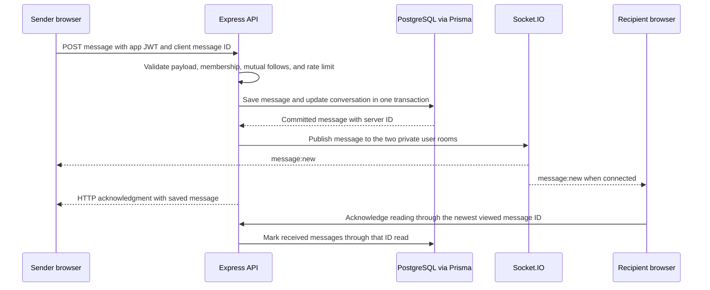
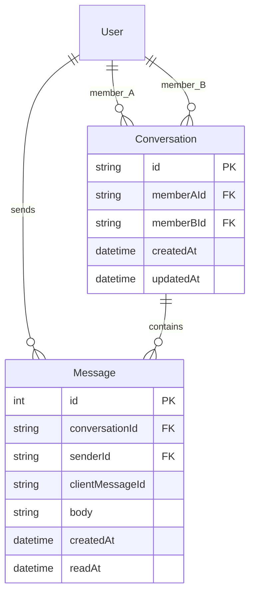

# One-to-One Messaging

## How to Try It

1. Sign in with two different Connectify users in separate browser profiles, private sessions, or devices.
2. Have each user follow the other. This mutual-follow requirement is checked on the server, not just in the UI.
3. Open the other person's profile and select **Message**.
4. Send a text message. The other account receives it live when connected.
5. Open **Messages** in the main navigation to revisit the conversation. Incoming messages appear in the unread count until viewed at the bottom of the active conversation.

For demonstrations with ngrok, keep the API and Vite running and tunnel the Vite frontend on port 5173. Its proxy forwards `/api` HTTP requests and `/socket.io` polling/WebSocket traffic to the API on port 5000. Local browser tests used this same proxy but did not independently validate an external ngrok connection.

## What Was Added

- A private one-to-one inbox with a responsive conversation list and chat view.
- A Message action on other users' profiles.
- Stored history, with 50 messages per page and a load-older action.
- Unread counts in the conversation list and main navigation.
- Sending/failed states, explicit retries, per-conversation drafts while the page stays mounted, and reconnect recovery through the database.
- A 2,000-character limit and a per-user limit of 30 write attempts per minute, including conversation starts.

This is text messaging only. It does not include attachments, group chats, typing indicators, visible read receipts, push notifications, or message deletion.

## Architecture

The existing React, Express, Prisma, and PostgreSQL structure stays in place. Socket.IO runs on the same HTTP server as Express; no separate messaging server or external chat provider is required.

The application deliberately separates **reliable writes over HTTP** from **live delivery over Socket.IO**:



The sender and recipient reconcile incoming events using the database message ID. Seeing an HTTP acknowledgment and a socket event for the same message does not create two bubbles.

Socket.IO does not itself persist messages and does not guarantee delivery of events missed during a disconnection. Connectify therefore reloads the latest history page on connection/reconnection and exposes older history separately. See [Socket.IO delivery guarantees](https://socket.io/docs/v4/delivery-guarantees/).

## Database Design



The member pair is sorted before creation, has a unique database constraint, and has an ordered/distinct-members check in the migration. Starting the same conversation from either profile reuses the existing thread, including concurrent starts.

Messages have increasing integer IDs for deterministic ordering and keyset history pagination. The unique `(senderId, clientMessageId)` pair makes sending idempotent: retrying the same message returns the stored record. Reusing an ID with a different body or conversation is not a new message and is rejected.

`readAt` is internal unread tracking, not an exposed read-receipt feature. A read acknowledgment must reference a message in the participant's conversation. It only updates incoming messages up to that ID, so it cannot mark a later message as already seen.

## API Endpoints

All endpoints require a Connectify Bearer JWT. The server derives the sender from that JWT; it does not accept a sender ID from the submitted body.

| Method and endpoint | Purpose |
| --- | --- |
| `GET /api/conversations` | List 30 conversations, current user ID, and total unread message count. |
| `GET /api/conversations?before=:conversationId` | Retrieve the next conversation page. |
| `POST /api/conversations` | Create/reuse a conversation with `{ targetUserId }`. |
| `GET /api/conversations/:id` | Load a participant-authorized conversation preview. |
| `GET /api/conversations/:id/messages` | Load the latest 50 messages, returned oldest-to-newest. |
| `GET /api/conversations/:id/messages?before=:messageId` | Load older messages. |
| `POST /api/conversations/:id/messages` | Save `{ body, clientMessageId }` and publish the saved message. |
| `POST /api/conversations/:id/read` | Mark incoming messages read through `{ throughMessageId }`. |

Conversation API pagination uses stable conversation creation order; the browser sorts the conversations it has loaded by recent activity. Socket notifications also fetch a specific affected conversation so an older thread can appear immediately when it receives a new message. No list endpoint returns an unbounded message history.

## Authorization and Delivery Safeguards

- Socket.IO validates the existing signed JWT and checks the user still exists. Tokens are sent in the socket auth payload, not a URL parameter.
- Only the server assigns a socket's private `user:<id>` room. There is no client-controlled room-join operation.
- History, previews, sends, and read acknowledgments verify conversation membership. Outsiders receive a generic not-found response rather than message contents.
- New conversations and new sends require mutual following. If either user unfollows, sending is paused; participants retain access to their history. Permission is checked on every send, even when the page has stale metadata.
- Strict request schemas reject blank/oversized messages and forged sender fields. React displays message bodies as text rather than HTML.
- Persisted messages are broadcast only after the database transaction commits.
- Expired JWTs terminate socket connections. Logout disconnects the current client's socket and clears its in-memory inbox state.
- Failures return controlled messaging errors rather than raw database exceptions.

The rate limit is process-local and is not a complete abuse-prevention system. It is separate from ngrok configuration; no tunnel policy or ngrok authentication setting was changed.

## Frontend Structure

| File | Responsibility |
| --- | --- |
| `components/MessagingProvider.tsx` | Owns the signed-in socket, inbox, unread total, reconnect state, and message subscriptions. |
| `components/ProfileMessageButton.tsx` | Starts/reuses a conversation and navigates to it. |
| `pages/MessagesPage.tsx` | Displays the inbox, history, composer, pending/failed messages, read acknowledgments, and mobile navigation. |
| `lib/messaging.ts` | Typed HTTP requests with request timeouts and controlled error handling. |
| `realtime/messaging.ts` in the API | Authenticates sockets and assigns private user rooms. |
| `services/messageService.ts` in the API | Participant checks, persistence, paging, follow permissions, and idempotency. |
| `routes/conversations.ts` in the API | Request validation, write throttling, HTTP responses, and post-commit notifications. |

The UI keeps drafts and failed sends only in memory while the Messages page remains mounted. Leaving it, reloading, or closing the tab can discard unsent text. Committed messages remain in PostgreSQL. Reconnecting reloads the latest history page rather than claiming the socket replayed every missed event.

## Verification

The integration suite uses a random set of temporary users, an ephemeral HTTP/Socket.IO server, and the configured PostgreSQL database. It deletes only those fixture users in cleanup; their conversations and messages cascade-delete. Do not point opt-in write tests at a production database.

From `apps/api`:

```powershell
$env:RUN_MESSAGING_DB_TESTS = '1'
npm.cmd exec --workspace api -- tsx --test tests/spotifyAuth.test.ts tests/messaging.test.ts
```

Without the opt-in environment variable, the messaging database suite skips. Authentication tests can still run independently.

The focused authentication and messaging run passed 18 tests, including sender/recipient delivery, persistence, concurrent conversation creation, duplicate retries, outsider access rejection, forged-sender rejection, unread boundaries, paginated/offline history, permission changes, rate limits, and socket expiry.

Browser checks used two separate authenticated contexts through Vite. They covered live messages in both directions, unread badge changes, refresh persistence, retry after going offline, loading older history, dark/light layouts at 320/390/1440 pixels, unfollow-based pause, and logout. Temporary browser users and their message history were removed afterward. No test message was sent to a real user.

## Limits Before a Public Launch

Messages are private to participants at the application/API level, but are **not end-to-end encrypted**. The backend and database can read their contents. Existing JWT/localStorage/session-revocation limitations still apply.

Before expanding beyond a capstone prototype, add blocking/reporting and moderation workflows, a clear retention/deletion policy, backup/access controls for message data, accessibility and stakeholder testing, shared rate limiting, and monitoring. Multiple API instances would also need a Socket.IO adapter and an appropriate load-balancing setup. See [Socket.IO reverse-proxy guidance](https://socket.io/docs/v4/reverse-proxy).
